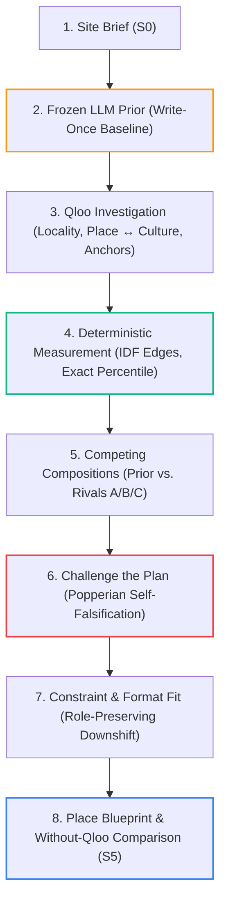
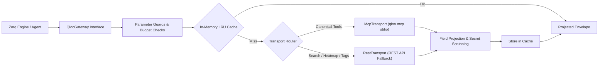

# ZORQ — System Architecture & Execution Contract (`ARCHITECTURE.md`)

> **Status:** Production-Ready & Verified (Post-Phase 10 Release Baseline)  
> **Live Deployment:** [https://zorq-12dk.onrender.com](https://zorq-12dk.onrender.com) (`/healthz` returns 200)  
> **Core Thesis:** Cultural composition intelligence for physical places.  
> **Protected Separation:** Qloo = external cultural measurement · Zorq deterministic code = all numeric truth · Agent = interpretation, probe selection, and explanation.

---

## 1. Architectural Philosophy & The Protected Loop

Zorq answers the core question of physical placemaking:
> *"What combination of people, culture, and belonging should this place host, and why?"*

Traditional placemaking relies on broker intuition, census demographics, and simple geographic proximity ("what is nearby"). However, proximity does not equal belonging, and ungrounded LLMs produce generic, median recommendations (the "popularity trap") without neighborhood-level cultural awareness.

Zorq executes a **protected 8-stage loop** where external cultural data competes with and refines a pre-registered baseline:



### Tripartite Separation of Concerns
1. **Qloo (External Cultural Measurement):** Locality taste heat (`urn:heatmap`), anchor identification, multi-scale insights (site vs. city), cross-domain affinity vectors (music, film, brands), taste neighborhoods ($N_k$), and second-route triangulation.
2. **Zorq Deterministic Engine (`src/server/engine/`):** Owns all arithmetic truth. Computes IDF-weighted cosine graph edges, mean composition coherence, exact null-model percentiles over all role-valid subsets, local-vs-city distinctiveness, weakest-link identification, triangulation classification, format fitting with circulation allowances, and Prior $\to$ Final diffs. **No number is ever authored by an LLM.**
3. **Agent Controller (`src/server/agent/`):** Bounded LLM controller routed via Rapid Router (`qwen/qwen3.7-flash-2026-07-15`). Formulates the initial Prior, selects empirical probes, nominates anchors, selects attacks during *Challenge the Plan*, and articulates evidence-bound rationales citing specific Evidence IDs.

---

## 2. Repository Map & Responsibility Ownership

Zorq is organized as a unified, type-safe monorepo in TypeScript (Node $\ge 22.19.0$, ESM native):

```text
C:\Users\LOUJAN B\Zorq\
├─ src/
│  ├─ shared/                    [shared contracts] Zod schemas shared across backend & frontend:
│  │  ├─ brief.ts                Brief schema, constraint enums, admired places
│  │  ├─ run.ts                  Canonical RunState, Prior, CandidatePool, Compositions, StressReport
│  │  ├─ events.ts               LedgerEvent and SSE wire frames
│  │  ├─ routes.ts               Request/Response schemas for all 12 API endpoints
│  │  ├─ redaction.ts            Secret and parameter scrubbing utilities
│  │  └─ errors.ts               Standardized ApiError and ApiErrorBody schemas
│  │
│  ├─ server/                    [backend API & agent runtime]
│  │  ├─ main.ts                 Process entry point, signal trapping, graceful shutdown
│  │  ├─ app.ts                  Express 5 application assembly, middleware pipeline
│  │  ├─ config.ts               Environment validation, limits, port derivation
│  │  ├─ healthz.ts              /healthz check with typed 503 degraded boot detection
│  │  ├─ logger.ts               Pino structured logging with automatic secret redaction
│  │  ├─ method.ts               Human-readable /method documentation provider
│  │  ├─ staticWeb.ts            Production static SPA asset server & fallback handler
│  │  ├─ version.ts               Package version metadata provider
│  │  ├─ middleware/             Helmet, rate limiting (express-rate-limit), request IDs, Zod validation
│  │  │
│  │  ├─ qloo/                   [qloo gateway] Transport-agnostic boundary:
│  │  │  ├─ gateway.ts           QlooGateway interface, retry/jitter, budget tracking, caching
│  │  │  ├─ mcpTransport.ts      Official Model Context Protocol (MCP) stdio JSON-RPC transport
│  │  │  ├─ restTransport.ts     Direct REST fallback transport (hackathon.api.qloo.com)
│  │  │  ├─ transport.ts        Transport abstraction and provenance builder
│  │  │  ├─ guards.ts            Pre-flight parameter validation & transport router
│  │  │  ├─ project.ts           Field projection & response payload sanitization
│  │  │  ├─ cache.ts             In-memory LRU cache with TTL
│  │  │  ├─ budget.ts            Strict Qloo call budget enforcement (<= 180 target, ~200 hard limit)
│  │  │  ├─ tagSuggestions.ts    S0 contextual tag rail provider
│  │  │  ├─ types.ts             Envelopes, operations, projected types
│  │  │  └─ errors.ts            QlooUpstreamError and sanitized error mapping
│  │  │
│  │  ├─ engine/                 [deterministic measurement kernel]
│  │  │  ├─ graph.ts             IDF-weighted taste vectors, cosine similarity, banded edges
│  │  │  ├─ compositions.ts      Exact null-model percentile enumeration, coherence, weakest-link
│  │  │  ├─ distinctiveness.ts   Local-vs-city contrast: 1 - cosine(site, city)
│  │  │  ├─ idf.ts               Inverse Document Frequency computation across candidate pool
│  │  │  ├─ neighborhoods.ts     Taste neighborhood vector construction
│  │  │  ├─ triangulation.ts     Second-route edge classification (confirmed / contested / thin)
│  │  │  ├─ grades.ts            Evidence grading engine (Grade A, B, C cap rule)
│  │  │  ├─ fit.ts               Physical footprint allocation & role-preserving downshifts
│  │  │  ├─ formats.ts           Component format library, noise classes, operating hours
│  │  │  ├─ ranking.ts           Multi-criteria composition ranking & Pareto sorting
│  │  │  ├─ edgeEntities.ts      Shared-entity extraction for evidence receipts
│  │  │  └─ types.ts             Domain engine interfaces and Zod models
│  │  │
│  │  ├─ agent/                  [bounded LLM controller]
│  │  │  ├─ controller.ts        Investigation loop, tool dispatcher, turn bounds (<= 3 turns)
│  │  │  ├─ prior.ts             Prior Lock generator (LLM-only baseline + unassisted polish)
│  │  │  ├─ siteScan.ts          Automated locality scanning & anchor candidate extraction
│  │  │  ├─ pool.ts              Candidate pool proposal & schema validation
│  │  │  ├─ ledger.ts            In-memory & append-only agent activity log
│  │  │  ├─ budget.ts            Real-time token cost tracking (<= $2.00 hard limit)
│  │  │  ├─ llm.ts               OpenAI-compatible client routed through Rapid Router
│  │  │  ├─ tools.ts             Declarative tool specifications for the LLM
│  │  │  └─ state.ts             RunState state transitions and status updates
│  │  │
│  │  ├─ orchestrator/           [run lifecycle & workflow coordination]
│  │  │  ├─ orchestrator.ts      Run execution orchestrator, lifecycle state machine, recovery
│  │  │  ├─ measure.ts           Measurement phase execution & graph assembly
│  │  │  ├─ challenge.ts         Automated Popperian stress-testing (5 attack vectors)
│  │  │  ├─ replace.ts           Role-preserving component replacement & delta scoring
│  │  │  ├─ blueprint.ts         Final Place Blueprint composition & snapshot token minting
│  │  │  ├─ rehydrate.ts         Run state reconstruction from persistence
│  │  │  ├─ writeThroughLedger.ts Atomic dual-write to store and active ledger
│  │  │  └─ status.ts            Lifecycle phase and status transitions
│  │  │
│  │  ├─ persistence/            [durable storage layer]
│  │  │  ├─ store.ts             RunStore interface contract
│  │  │  ├─ tursoStore.ts        Turso (libSQL/SQLite) persistent store
│  │  │  ├─ memoryStore.ts       In-memory store fallback for zero-dependency operation
│  │  │  └─ errors.ts            Storage conflict and lookup errors
│  │  │
│  │  └─ sse/                    [real-time event streaming]
│  │     ├─ hub.ts               Connection management and broadcast routing
│  │     ├─ stream.ts            SSE connection negotiation and Last-Event-ID replay
│  │     └─ frames.ts            Typed wire frame serialization
│  │
│  └─ web/                       [frontend React 19 SPA]
│     ├─ main.tsx                React root mounting and router setup
│     ├─ App.tsx                 Route declarations (/, /run/:id, /run/:id/blueprint, /method)
│     ├─ presets.ts              Curated test cases (SoHo, Nashville, Reading Terminal)
│     ├─ store/runStore.ts       Zustand store (projection of server RunState, view only)
│     ├─ lib/                    API client, SSE stream consumer, MapLibre helpers, geocoder
│     ├─ routes/                 HomeRoute, RunRoute, BlueprintRoute, MethodRoute
│     ├─ screens/s0/             Brief formulation, address autocomplete, Qloo tag rail
│     ├─ screens/s1/             Investigation workspace, Prior card, Agent Ledger, Map, DNA strip
│     ├─ screens/s2/             The Field histogram, composition cards, familiar/distinctive dial
│     ├─ screens/s3/             Map of Meaning (MDS layout), Distance matrix, Evidence drawer
│     ├─ screens/s4/             Challenge the Plan interface, attack streams, verdict banners
│     ├─ screens/s5/             Place Blueprint, margin receipts, slope chart, Without-Qloo modal
│     └─ styles/                 Architectural drafting design system ("ink on paper")
│
├─ deployment/                   [operations & deployment]
│  ├─ Dockerfile                 Multi-stage slim container (build -> runtime)
│  ├─ render.yaml                Render Web Service infrastructure-as-code
│  └─ render-deploy.mjs          Idempotent deployment and verification script
│
├─ tests/                        [verification test suite]
│  ├─ engine/                    Deterministic math kernels, IDF, null-model, distinctiveness
│  ├─ qloo/                      Gateway boundaries, caching, budget limits, mock & live tests
│  ├─ agent/                     Prior Lock, controller limits, budget tracking, tools
│  ├─ orchestrator/              Lifecycle, idempotency, challenge attacks, replacement, recovery
│  ├─ persistence/               Store contracts, Turso integration, memory fallback
│  ├─ api/                       End-to-end HTTP route execution & error envelopes
│  └─ web/                       UI state models, tab transitions, SSE stream reconciliation
│
├─ docs/                         [documentation & verification evidence]
│  ├─ devpost-description.md     Official hackathon project submission brief
│  ├─ qloo-removal-proof.md      Empirical Without-Qloo ablation analysis
│  └─ release-audit.md           Security, anti-pattern, and quality gate audit record
│
├─ .github/workflows/
│  ├─ ci.yml                     Automated CI: install -> typecheck -> lint -> test -> build
│  └─ health-ping.yml            Scheduled 10-minute keep-alive ping to prevent cold starts
│
├─ AGENTS.md                     Engineering contract and operating system for coding agents
├─ LICENSE                       Open-source MIT License
└─ package.json                  Pinned scripts and dependencies
```

---

## 3. Canonical Run State Hierarchy

The system operates around a single, validated, canonical `RunState` object defined in `src/shared/run.ts`. Every state transition is atomic and recorded in the database:

```text
RunState
├── id: string (UUIDv4)
├── status: "created" | "running" | "stopped" | "completed" | "failed"
├── phase: "s0_brief" | "s1_investigate" | "s2_compositions" | "s3_graph" | "s4_challenge" | "s5_blueprint"
├── brief: Brief (User-submitted site constraints and operational goals)
├── prior: Prior [WRITE-ONCE, IMMUTABLE]
│   ├── composition: string[] (Initial unassisted component guesses)
│   ├── unassistedPolish: string (LLM-only narrative generated before external data)
│   ├── generatedAt: string (ISO timestamp)
│   └── qlooUsed: false (Enforced baseline invariant)
├── siteRead: SiteRead (Qloo heatmap coordinates, selected anchor pins A-E)
├── culturalDna: CulturalDNA (Local vs. city affinity profiles across Artists/Films/Brands)
├── candidatePool: CandidateComponent[] (Grounding entities with provenance chains)
├── neighborhoods: RunNeighborhoods (30-element weighted vectors per component)
├── graph: CultureGraph (IDF-weighted cosine edges, banded into strong/typical/weak)
├── compositions: RunRankedComposition[] (Prior + Rivals A/B/C with coherence percentiles)
├── stressReport: ChallengeReport (Popperian attacks: ablation, substitution, bridge, catchment, rival)
├── constraintFit: FitResult (Usable footprint, hours, role-preserving format downshifts)
├── revisions: RunRevision[] (Append-only log of unpin/replace/mutation operations)
├── evidence: RunEvidenceNode[] (Itemized claim receipts citing raw Qloo provenance)
└── ledger: LedgerRow[] (Streaming activity log: kind ∈ Qloo | Compute | LLM)
```

### Invariant Rules on State Ownership
- **Single Authority:** The database is the authoritative recovery source of truth; SSE is progressive visibility only.
- **Write-Once Prior:** The `Prior` node is written once at run creation and frozen in amber. No downstream calculation or agent prompt can mutate it.
- **Client Projection:** Frontend state (`useRunStore`) is a read-only projection of `RunState`. The client never calculates numbers, invents IDs, or re-ranks cards locally except via documented user dials.

---

## 4. API Surface & Wire Contracts

Zorq exposes 12 strictly typed endpoints. All requests and responses are validated via Zod at the boundary.

### Standardized Error Envelope
Every non-2xx response returns a uniform `ApiErrorBody`:
```json
{
  "error": {
    "code": "VALIDATION_FAILED",
    "message": "Human-readable description without credentials",
    "details": [{ "path": "brief.areaSqFt", "message": "Expected positive number" }],
    "requestId": "req-9a8f2b..."
  }
}
```

### Endpoint Register

| Method | Endpoint | Purpose | Key Invariant |
|---|---|---|---|
| `GET` | `/healthz` | Platform health monitoring | Returns 200 when configured; returns typed 503 naming missing env vars without leaking values. |
| `POST` | `/api/qloo/tags` | Contextual S0 tag suggestion rail | Bounded preview ($\le 8$ suggestions); resolves objective to Qloo tags without creating a run. |
| `POST` | `/api/runs` | Initializes a run & locks Prior | Creates the frozen Prior (`qlooUsed: false`) **before** invoking any Qloo investigation probe. |
| `GET` | `/api/runs/:id` | Full Run state fetch | Primary state replay source after browser refresh or reconnect. |
| `GET` | `/api/runs/:id/events` | SSE event stream | Real-time ledger and state streaming; supports `Last-Event-ID` monotonic replay. |
| `POST` | `/api/runs/:id/stop` | Halts execution | Idempotent; captures the best defensible partial state without fabricating completion. |
| `POST` | `/api/runs/:id/unpin-anchor` | Anchor removal | Removes an anchor pin and deterministically re-evaluates Cultural DNA ($\le 3$ Qloo calls). |
| `POST` | `/api/runs/:id/replace` | Role-preserving component swap | Swaps a node with pool rivals or custom query ($\le 4$ calls); computes $\Delta\text{Coherence}$. |
| `POST` | `/api/runs/:id/challenge` | Triggers self-falsification | Executes 5 Popperian attacks; returns `Survived`, `Revised`, or `Replaced` with reason. |
| `POST` | `/api/runs/:id/recompute` | Physical constraint re-fit | Re-fits formats and hours; **never regenerates the Prior** (zero Qloo calls for area re-fit). |
| `GET` | `/api/runs/:id/blueprint` | Board-ready decision artifact | Generates sanitized blueprint snapshot; supports public share tokens (`?share=...`). |
| `GET` | `/api/method` | Measurement contract | Discloses exact formulas, heuristics, and proofs of separation between Zorq and Qloo. |

---

## 5. Qloo Integration & Dual-Transport Architecture

Qloo is Zorq’s external cultural intelligence layer. The system uses a **dual-transport design** managed transparently behind the `QlooGateway` interface:



### Transport Responsibilities
1. **Official MCP Transport (`McpTransport`):** Runs the official `@qloo/qloo-harness` via stdio JSON-RPC. Used for `qloo_capabilities`, `qloo_recommend`, `qloo_rank`, `qloo_describe`, `qloo_where_popular`, `qloo_compare_audiences`, `qloo_entity_tags`, and `qloo_audience_demographics`.
2. **REST Transport Fallback (`DirectQlooTransport`):** Handles essential capabilities not exposed in the canonical MCP toolset:
   - Free-text entity search: `GET /search?query=...&type=urn:entity:...`
   - Geographic locality heat: `GET /v2/insights` with `filter.type=urn:heatmap`
   - Canonical tag resolution: `GET /v2/tags?filter.query=...`
   - Cross-domain taste neighborhoods with high entity limits.

### Qloo Operational Controls
- **Call Budgeting (`QlooCallBudget`):** Target $\le 180$ calls/run; hard ceiling of $200$; concurrency pool limited to $6$ via `p-limit`.
- **Response Caching (`QlooEnvelopeCache`):** In-memory LRU cache with a 6-hour TTL indexed by normalized operation and request parameters.
- **Field Projection:** Upstream payloads (often 0.2–1.0 MB) are projected into lean, typed domain models before persisting or transmitting over SSE, minimizing memory footprint and eliminating credential leakage.

---

## 6. Deterministic Engine & Mathematical Foundations

All numbers, scores, and rankings in Zorq are computed by deterministic TypeScript kernels in `src/server/engine/`.

### 1. IDF-Weighted Cosine Graph (`graph.ts` & `idf.ts`)
To compute the shared cultural affinity between components $A$ and $B$, their multi-domain taste neighborhoods (top 30 entities across music, film, and brands) are vector-aligned. Mainstream global entities (e.g., Starbucks, Taylor Swift) are down-weighted using Inverse Document Frequency:
$$\text{idf}(e) = \ln\left(1 + \frac{N}{| \{c \in \text{Pool} : e \in \text{domain}(c)\} |}\right)$$
The edge strength is computed as:
$$\text{similarity}(A, B) = \frac{\sum_{e} (w_{A, e} \cdot \text{idf}(e)) \cdot (w_{B, e} \cdot \text{idf}(e))}{\sqrt{\sum_{e} (w_{A, e} \cdot \text{idf}(e))^2} \cdot \sqrt{\sum_{e} (w_{B, e} \cdot \text{idf}(e))^2}}$$

### 2. Exact Null-Model Percentile Scoring (`compositions.ts`)
Instead of an arbitrary 0–100 score, Zorq measures coherence against the complete combinatorial universe of valid options. For a pool of $N$ candidates requiring size $K$ with designated roles (Anchor, Social, Discovery, Experience, Night, Community):
1. **Combinatorial Enumeration:** The engine enumerates all valid subsets meeting the role criteria:
   $$\text{Total Subsets} = \binom{N}{K} \quad (\approx 252 \text{ combinations for } N=10, K=5)$$
2. **Mean Coherence:** The coherence of each combination is the mean of all internal pair edges:
   $$\text{coherence}(C) = \frac{1}{\binom{K}{2}} \sum_{\{u, v\} \subseteq C} \text{similarity}(u, v)$$
3. **Exact Percentile:** The target composition is assigned its exact percentile rank:
   $$\text{Percentile} = \frac{|\{C' \in \text{ValidSubsets} : \text{coherence}(C') < \text{coherence}(C)\}|}{|\text{ValidSubsets}|} \times 100$$

### 3. Local Distinctiveness (`distinctiveness.ts`)
To prevent the popularity trap, Zorq compares taste signals at the site radius ($V_{\text{site}}$) against the broader city baseline ($V_{\text{city}}$):
$$\text{Distinctiveness}(k) = 1 - \text{cosine}(V_{\text{site}}, V_{\text{city}})$$
High distinctiveness indicates that a component reflects hyper-local culture rather than generic metropolitan trends.

### 4. Second-Route Triangulation & Evidence Grades (`grades.ts`)
Every edge in the leading composition is subjected to an independent second-route query and classified into a `TriangulationState`:
- `confirmed`: Supported by strong independent audience overlap.
- `contested`: Conflicting or ambiguous second-route signals.
- `thin`: Insufficient density to confirm the relationship.

The composition receives an overall evidence grade governed by a strict cap rule:
- **Grade A:** Every finalist edge is `confirmed`.
- **Grade B:** Any edge is `contested`, `thin`, or encountered a probe failure.
- **Grade C:** Any member in the leader composition remains unmeasured.

### 5. Constraint & Format Downshifting (`fit.ts` & `formats.ts`)
Physical feasibility is enforced using a deterministic format library:
- **Circulation Allowance:** 85% usable factor (`CIRCULATION_ALLOWANCE = 0.85`).
- **Role-Preserving Downshifts:** When footprint or noise constraints are exceeded, the engine downshifts format scale rather than dropping the role (e.g., *"Cinema becomes micro-screening. Role preserved: Anchor"*).

---

## 7. Persistence, Durability & Recovery Architecture

Zorq guarantees zero data loss and seamless recovery across disconnections, server restarts, and browser refreshes:

```text
┌────────────────────────────────────────────────────────┐
│ Express API / SSE Hub                                  │
└──────────────────────────┬─────────────────────────────┘
                           │ WriteThroughLedger
            ┌──────────────┴──────────────┐
            ▼                             ▼
┌───────────────────────────┐ ┌───────────────────────────┐
│ Active Run Memory Cache   │ │ Turso (libSQL) Store      │
│ Low-latency execution     │ │ Durable relational state  │
└───────────────────────────┘ └───────────────────────────┘
```

### Database Schema (`src/server/persistence/tursoStore.ts`)
- `runs`: Stores `id`, `status`, `phase`, full JSON `state_json`, timestamps.
- `ledger_events`: Append-only log indexed by `(run_id, sequence)` storing every `Qloo`, `Compute`, and `LLM` step.
- `evidence`: Stores immutable `(run_id, evidence_id)` records containing raw provenance citations.
- `blueprint_snapshots`: Stores published snapshots indexed by `share_token` with expiration timestamps.

### Recovery Invariants
- **Reconnection with `Last-Event-ID`:** When a browser reconnects over SSE, the server replays missed events from the persistent log starting at the requested sequence number.
- **Honest Partial States:** If external dependencies fail or the user triggers a stop, the system commits the best defensible partial state with an explicit status. It never fabricates completion.

---

## 8. Security, Integrity & Trust Boundaries

1. **Zero Secret Leakage:**
   - `QLOO_API_KEY`, `RAPIDROUTER_API_KEY`, and `TURSO_AUTH_TOKEN` exist only in server environment variables.
   - All server responses, SSE frames, errors, and Pino logs pass through `scrubSecrets()` to redact sensitive parameters.
   - The browser client never communicates with Qloo or the LLM directly.
2. **Public-by-Design Map Token:**
   - `VITE_MAPTILER_KEY` is the only frontend-visible variable, explicitly scoped for map tile rendering and geocoding.
3. **Boundary Sanitization:**
   - External data from Qloo and Rapid Router is treated as untrusted and validated against strict Zod schemas before entering the state graph.
   - All markdown and narrative text rendered in the blueprint is sanitized to prevent injection attacks.
4. **Hardened HTTP Pipeline:**
   - Protected by `helmet` security headers, strict CORS, per-IP rate limiting (`express-rate-limit`), and unique correlation `requestId` tracking.

---

## 9. Verification & Quality Gates

Every increment of Zorq is validated across a multi-tier testing ladder:

```text
Typecheck (tsc --noEmit)
  └── Lint (eslint)
        └── Unit & Kernel Tests (Vitest)
              └── Integration & API Routes (Vitest)
                    └── Production Build (tsc + vite)
                          └── Deployed Service Smoke (/healthz)
```

- **Deterministic Verification:** Tests prove that identical brief inputs produce byte-identical graph edges, percentiles, and distinctiveness scores across runs.
- **Ablation & Anti-Pattern Auditing:** Automated tests verify that unconfigured keys yield typed 503 errors and that zero mock or hardcoded results exist in production code paths.
- **Production CI:** [`.github/workflows/ci.yml`](file:///C:/Users/LOUJAN%20B/Zorq/.github/workflows/ci.yml) enforces clean installation, typechecking, linting, test execution (830+ tests), and production compilation on every commit.

---

## 10. Blocker & Milestone Resolution Register

All historical development gates and blockers are fully resolved in the production baseline:

| Identifier | Description | Resolution & Evidence |
|---|---|---|
| **Gate A (MCP)** | Qloo MCP transport integration | **RESOLVED:** Implemented via stdio JSON-RPC using `@qloo/qloo-harness`; canonical tools active with REST fallback for search and heatmaps. |
| **B-02** | LLM Gateway Availability | **RESOLVED:** Routed through Rapid Router (`qwen/qwen3.7-flash-2026-07-15`) with real-time token budget tracking ($\le \$2.00$). |
| **B-06** | Map & Persistence Services | **RESOLVED:** MapLibre + MapTiler autocomplete integrated on S0/S1; Turso libSQL client operational with memory fallback. |
| **D-0.6** | Containerization | **RESOLVED:** Multi-stage `deployment/Dockerfile` running live on Render Free tier with automated keep-alive health pings. |
| **Phase 10** | Release & Red-Team Audit | **RESOLVED:** 830+ tests passing, zero secrets in source, live production deployment verified at `https://zorq-12dk.onrender.com`. |

---
*Authored and locked for the Zorq production repository.*
