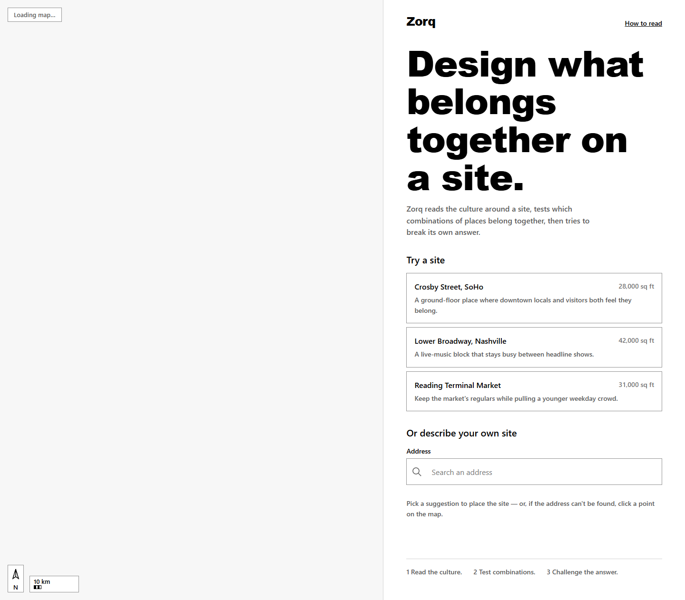
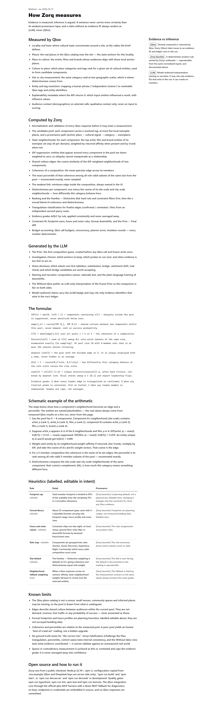

# Zorq

**Cultural composition intelligence for physical places.**

Zorq is an autonomous cultural composition agent: it takes a brief for a site, freezes an
LLM-only Prior before touching any data, investigates the locality with Qloo's taste and
locality intelligence, measures cultural relationships deterministically, assembles competing
compositions (Prior + A/B/C), stress-tests its own recommendation ("Challenge the Plan"), fits
the result to physical and operating constraints, and produces an evidence-bound
**Place Blueprint** — plus an honest *Without-Qloo* comparison showing what the evidence changed.

The deletion test: remove Qloo and Zorq loses the shared-culture edges between components, the
local-vs-city distinctiveness readings, the provenance path behind every candidate, and the
reason the Prior changed. Zorq never manufactures divergence: on a control site it says plainly
that the evidence confirmed the first guess.

## Status

Submission candidate for the [Qloo Agentic Hackathon 2026](https://qloo.devpost.com/)
(project started 2026-10-06). Phases 1–8 of the
[implementation plan](./ProjectSpec/IMPLEMENTATION_PLAN.md) are built and verified.
Phase 9 (deployment & judge readiness) is in progress. The service is deployed and live:
**Live demo: <https://zorq-12dk.onrender.com>** (`/healthz` returns 200; the Docker image is built
on Render at deploy time).

| Surface | State |
|---|---|
| `/` brief → Prior → S1 investigation → S2 compositions → S3 connections → S4 challenge → S5 blueprint | built, judge-path-tested |
| `/run/:id/blueprint` read-only shareable snapshot | built |
| `/method` (how Zorq measures: formulas, heuristics, limits) | built |
| Health endpoint `/healthz` | built (503 typed degraded boot is the documented contract) |
| Docker / Render deployment contract | in [`deployment/`](./deployment) (image builds on Render — Docker is not available on the dev machine) |
| CI | on-push gates + scheduled public `/healthz` ping in [`.github/workflows/`](./.github/workflows) |

## Architecture in one diagram

```text
USER BRIEF → FROZEN LLM PRIOR → QLOO SITE READ → CULTURAL DNA
  → EVIDENCE-BEARING CANDIDATE POOL → DETERMINISTIC SHARED-CULTURE GRAPH
  → EXACT COMPOSITION SEARCH + NULL MODEL → PRIOR + THREE RIVALS
  → TRIANGULATION + CHALLENGE-THE-PLAN → CONSTRAINT / FORMAT FIT
  → EVIDENCE-BOUND BLUEPRINT → WITHOUT-QLOO PROOF + USER REVISION
```

Separation of powers (non-negotiable):

| Layer | Owns | Never owns |
|---|---|---|
| **Qloo** (official `qloo mcp` + REST fallback) | cultural measurement: locality, place→culture, culture→place, site-vs-city reads, explainability where supported | any Zorq number |
| **Zorq deterministic code** | validation, taste neighborhoods, IDF-weighted edges, mean coherence, exact percentile over role-valid subsets, distinctiveness, weakest link, triangulation classification, evidence grades, constraint fit, budgets, Prior→Final diff | subjective prose |
| **LLM (Rapid Router → Qwen `qwen/qwen3.7-flash-2026-07-15`)** | Prior generation, anchor/probe/attack selection, naming, rationale, downshift wording | any numeric truth, any evidence ID |

Every claim in the UI carries one of three provenance badges — `[Qloo]`, `[Zorq heuristic]`,
`[LLM]` — and every `[Qloo]` claim opens evidence that traces claim → evidence ID → ledger event
→ measurement input. Unknown evidence IDs never render as Qloo evidence.

## Qloo integration

| Capability | Zorq use | Evidence surfaced |
|---|---|---|
| `qloo_capabilities` (MCP startup) | credential/runtime check before a run | health + ledger rows |
| Entity/place search | resolve admired places and site names to canonical IDs | brief autocomplete, provenance paths |
| Tag search / resolution | never hardcode tag URNs; resolve per category | component tags in the pool |
| Locality/heat (`urn:heatmap`, REST path) | where taste concentrates near the site | S1 map heat + anchor pins |
| Place insights at site and city scale | local anchors; the two-scale read behind distinctiveness | DNA strip, distinctiveness readings |
| Place → culture (place IDs as taste signals) | artists/films/brands around the anchors | Cultural DNA entities |
| Culture → place (entities as signals) | candidate components with a defensible path | pool provenance paths |
| Taste neighborhoods (entities as signals) | per-component neighborhoods used for the graph | edge receipts |
| Second route on finalist edges | triangulation: confirmed / contested / thin | edge drawer + evidence grade |
| Bridge / replace probes | repair weak edges; role-preserving alternatives | Challenge artifacts, Replace panel |
| Explainability where returned | which entities influenced a result | evidence drawer detail |

Why Qloo is indispensable: without it there is no measurement of which components *share an
audience here* (the graph has nothing to draw), no local-vs-city contrast to resist the
popularity trap, and no evidence path behind any candidate — so the Prior cannot honestly
change. The LLM-only Before/After comparison in S5 makes that dependency inspectable per run.

## Run it

**Prerequisites:** Node.js ≥ 22.19 + npm, Git, and Google Chrome (the E2E suite launches your
installed system Chrome via Playwright's `channel: "chrome"` — it never downloads a browser).

```bash
npm ci
cp .env.example .env   # fill NODE_ENV / APP_BASE_URL first; keys are server-side only
npm run typecheck
npm run lint
npm test               # Vitest unit/integration suites
npm run test:e2e       # builds the production bundle, starts it, drives the judge path
npm run build
npm start              # serves the built SPA + API on one origin
curl http://localhost:3000/healthz
```

`/` gives three preset briefs; create a run and the workspace streams the investigation over
SSE. Creating a run without Qloo/Rapid Router keys answers a *typed* `DEPENDENCY_UNAVAILABLE`
envelope — degraded behavior is state, not a crash. Real runs require the server-side keys
(`QLOO_API_KEY`, `RAPIDROUTER_API_KEY`; optional `TURSO_*` persistence, `VITE_MAPTILER_KEY`).

Repositories detail: [`ARCHITECTURE.md`](./ARCHITECTURE.md) is the repository contract and
[`HACKATHON_TRACKER.md`](./HACKATHON_TRACKER.md) tracks competition requirements and gates.

## Screenshots

Real product surfaces captured from the production build (`docs/screenshots/`):





Narrow (360px) variants sit beside them. Screens showing Qloo-derived measurements are captured
from live runs with real keys and added at submission freeze — never from test fixtures, so the
gallery cannot present manufactured data as evidence.

## Deployment

Render Free Docker web service (same origin for the React build + Express API + agent + Qloo
MCP runtime). The reviewed contracts live in [`deployment/Dockerfile`](./deployment/Dockerfile)
and [`deployment/render.yaml`](./deployment/render.yaml); the image is validated on Render at
deploy time. The server listens on the platform-injected `PORT` when present, then `APP_BASE_URL`,
then 3000. `GET /healthz` returns 200 when configured and a typed 503 naming any missing
required variables otherwise; a ten-minute scheduled GitHub Actions ping keeps the free tier warm
(see `.github/workflows/health-ping.yml`; set the repository variable `HEALTHZ_URL`).

## Limitations (honest, current)

- The Qloo place catalog is not a census; small or informal venues can be missing.
- Edges describe shared culture between audiences *within the measured pool* — never demand,
  revenue or success probability.
- Format footprints and hours profiles are `[Zorq heuristic]` planning ranges, labelled and
  documented on `/method`.
- Coherence and percentiles are relative to the measured pool; no ground truth exists for
  "the right mix".
- Qloo quota/rate-limit numbers are still unpublished by the organizers; call budgets
  (≤ 180 target, ≈ 200 ceiling, concurrency ≤ 8) are engineering defaults pending measurement.
- Qloo responses are large (0.2–1.0 MB, field projection mandatory) and the raw affinity band is
  compressed; deltas are normalized, never presented as raw gaps.
- Docker is not available on this dev machine; container builds are validated on Render.

## Security notes

- Qloo, Rapid Router, Turso and MapTiler credentials live only in server-side environment
  variables; never in the browser bundle, Git history, logs, screenshots or this README.
- Qloo is never called from the browser; Qloo and LLM output are treated as untrusted input and
  validated at the boundary.
- No Qloo responses are stored or committed; only Zorq-owned, sanitized run state is persisted
  (`PERSIST_QLOO_DERIVED=false` by default).
- Helmet, per-IP rate limiting, request IDs, and secret-redacted Pino logging are active.

## License

[MIT](./LICENSE)
